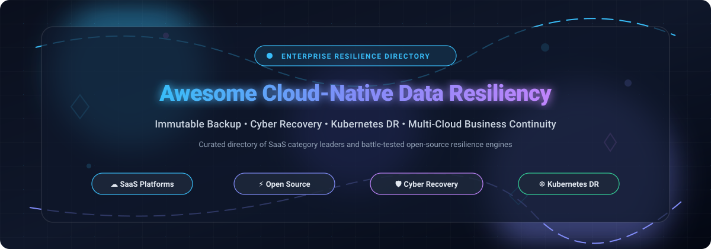

  

# 🛡️ Awesome Cloud-Native Data Resiliency Platform

  
  
  
  
  
  
  

---

## 🌐 Top Cloud-Native Data Resiliency Platform Ecosystem

> **Curated List of SaaS Products & Open-Source GitHub Projects**  
> *Focused on Cyber Resilience, Immutable Backup & Multi-Cloud Data Protection*  
> 📅 **Last updated: March 2026**

This repository tracks top-tier **SaaS platforms** and **open-source projects** in **Cloud-Native Data Resiliency**. These platforms deliver the centralized control plane for protecting critical data assets across SaaS suites, cloud workloads, and hybrid infrastructure—covering immutable backups, automated ransomware detection, cleanroom recovery, and continuous compliance auditing.

- ☁️ **SaaS Leaders**: Rubrik Security Cloud, Veeam Data Platform, Cohesity Cloud Services, Commvault Cloud, Acronis Cyber Cloud, Datto Cloud, Druva Cloud Platform, HYCU R-Cloud, Rewind, and Clumio.
- ⚡ **Open-Source Resilience Stack**: Self-hosted backup engines, cloud DR orchestration, persistent volume replication, and Kubernetes data protection—engineered for SREs, platform engineers, and DevSecOps practitioners who demand transparent, vendor-neutral data resilience.

Contributions are warmly welcomed! Feel free to open a PR to add or update entries. Please ensure descriptions remain factual with direct links to official repositories or sites.

---

## 📑 Table of Contents
- [📊 Sector Overview & Market Dynamics](#-sector-overview--market-dynamics)
- [☁️ SaaS/Hosted Platforms](#️-saashosted-platforms)
- [⚡ Open-Source GitHub Projects](#-open-source-github-projects)
- [🛠️ How to Contribute](#️-how-to-contribute)
- [💖 Support](#-support)
- [⭐ Star History](#-star-history)
- [⚠️ Disclaimer](#️-disclaimer)

---

## 📊 Sector Overview & Market Dynamics

The global data resilience and cloud backup/recovery market is valued at approximately **$22.8B–$26B in 2025–2026** (scaling past $38B by the early 2030s at a ~15% CAGR), propelled by escalating ransomware threats, multi-cloud complexity, and zero-trust mandate requirements. The sector is **moderately fragmented with clear tier-one consolidation**: while category leaders (Rubrik, Veeam, Commvault, Cohesity) control significant enterprise market share, specialized vendors and open-source ecosystems maintain persistent footholds across Kubernetes, cloud-native SaaS workloads, and edge environments.

---

## ☁️ SaaS/Hosted Platforms

| Product | Company Size (Valuation / Revenue) | Description | Pricing (Starting) | Free Tier / Trial Limits |
|:---|:---|:---|:---|:---|
| 🛡️ **[Rubrik Security Cloud](https://www.rubrik.com/)** | **~$22B Market Cap** (~$1.5B ARR / Revenue, NYSE: RBRK) | Cyber resilience platform with immutable zero-trust backups, AI anomaly detection, and automated recovery orchestration. | **$3.80/user/month** for SaaS/M365 Foundation; list storage pricing starts at ~$130–$230/BETB/month (enterprise quote). | **30-day guided POC / free trial** upon enterprise request (sandbox environment with sample data; no perpetual free plan). |
| 🔄 **[Veeam Data Platform](https://www.veeam.com/)** | **~$15B Valuation** (~$1.8B–$2B ARR, Private) | Enterprise data protection with backup, replication, and instant recovery across cloud, virtual, physical, and SaaS workloads. | **$12.92/workload/month** (~$155/workload/year via 10-instance packs on VUL licensing). | **Community Edition**: free forever for up to 10 workloads/instances (full backup & replication features, community support). |
| 🏢 **[Cohesity Cloud Services](https://www.cohesity.com/)** | **~$7B–$8B Valuation** (~$1.5B–$1.7B ARR combined with Veritas, Private) | AI-powered multicloud data security and Backup-as-a-Service (BaaS) across AWS, Azure, and Google Cloud with FortKnox isolation. | **$29,100/year** entry commit on AWS Marketplace (~10 BETB capacity baseline; or ~$150/TB/month). | **30-day free trial** with up to **5 FE TiB** (Front-End Terabytes) capacity limit upon sales evaluation registration. |
| 🗄️ **[Commvault Cloud](https://www.commvault.com/)** | **~$6.7B Market Cap** (~$1.18B Revenue, NASDAQ: CVLT) | Unified data protection with immutable air-gapped recovery copies, metallic architecture, and cleanroom recovery testing. | **$58.50/TB/month** for cloud object/file data; M365 SaaS protection from **$1.70/user/month**. | **30-day free trial**: protect multiple workloads simultaneously without credit card, expires after 30 days. |
| 💼 **[Datto Cloud](https://www.datto.com/)** | **$6.2B Acquisition** (by Kaseya, ~$450M+ ARR) | Business continuity and disaster recovery (BCDR) for MSPs, including SIRIS hardware/virtual appliances with cloud virtualization. | **$995 one-time appliance** (SIRIS 5) + monthly cloud service subscription; SaaS Protection from **$1.50–$3.00/user/month**. | **14-day free trial** for SaaS Protection (M365/Google Workspace sandbox via MSP partner portal; hardware POC on request). |
| 🔒 **[Acronis Cyber Cloud](https://www.acronis.com/)** | **~$3.5B–$4.0B Valuation** (~$500M Revenue, Majority PE: EQT) | Cyber protection platform combining backup, disaster recovery, vulnerability management, and AI-based anti-ransomware. | **$5.00/workload/month** (workstation baseline; servers higher) or usage-based consumption starting at **~$0.07/GB/month**. | **30-day free trial** with full platform capabilities and cloud storage quota; no permanent free tier. |
| ☁️ **[Druva Cloud Platform](https://www.druva.com/)** | **~$2.0B Valuation** (~$200M+ ARR, Private) | 100% SaaS cloud data resiliency platform with agentless backup, global deduplication, and automated cleanroom recovery. | **$8.00/user/month** for endpoints/M365; Hybrid cloud workloads start at ~$210/TB/year. | **Developer Sandbox**: free for 1 year with limited storage for API/integration testing; standard platform offers a **30-day free trial** (up to 1 TB). |
| 🌐 **[HYCU R-Cloud](https://www.hycu.com/)** | **~$350M–$500M Valuation** (~$140M total funding, Private) | Multi-cloud and SaaS data protection platform supporting 100+ integrations across AWS, Azure, GCP, and enterprise SaaS apps. | **$1.20/user/month** for IAM/Entra ID backup ($2.25/user/month for M365, $4.00/user/month for Jira/GitHub); starter bundle from $5,000/year. | **14-day free trial** for cloud/SaaS integrations (30 days for select identity apps; unmetered testing with cloud storage pass-through). |
| ⏪ **[Rewind](https://rewind.com/)** | **~$150M–$250M Valuation** (Majority PE: H.I.G. Growth, $80M+ raised) | Automated backup, restore, and resilience solution tailored for SaaS platforms (Shopify, GitHub, Jira, Confluence, QuickBooks). | **$4.00/user/month** (Standard plan) or **$5.20/user/month** (Advanced plan); GitHub repositories starting from $9.00/month. | **14-day free trial** (7 days on Shopify App Store) with full automated backups and granular restore testing included. |
| 🚀 **[Clumio](https://www.clumio.com/)** | **~$100M–$150M Valuation** ($260M total raised, Private) | Fully managed, air-gapped cloud data protection and instant recovery engine optimized for Amazon S3, DynamoDB, and EC2. | **$0.025/GB/month** (~$25/TB/month) for AWS cloud data protection (API & Terraform driven). | **14-day free trial** on AWS Marketplace with access to S3/EC2 backup pipelines and restore benchmarking. |

---

## ⚡ Open-Source GitHub Projects

Ranked by GitHub stargazers count:

| Project | Stars | Description |
|:---|:---:|:---|
| 📦 **[Rclone](https://github.com/rclone/rclone)** |  | "rsync for cloud storage" supporting over 70 cloud object stores, encrypted remotes, chunking, and multi-cloud sync pipelines. |
| 🔐 **[Restic](https://github.com/restic/restic)** |  | Fast, secure, deduplicated backup program using cryptography. Supports local, SFTP, REST, S3, Azure Blob, and Google Cloud Storage. |
| 🗜️ **[Duplicati](https://github.com/duplicati/duplicati)** |  | Free backup software with built-in AES-256 encryption, web UI, incremental deduplication, and multi-backend cloud targets. |
| 💾 **[Kopia](https://github.com/kopia/kopia)** |  | Cross-platform, fast, encrypted snapshot backup tool with deduplication, client-side compression, desktop GUI, and server API mode. |
| 🗃️ **[BorgBackup](https://github.com/borgbackup/borg)** |  | Deduplicating archiver with authenticated encryption. Extremely efficient for daily snapshots, offsite servers, and SSH targets. |
| ☸️ **[Velero](https://github.com/vmware-tanzu/velero)** |  | Kubernetes standard for disaster recovery, cluster migration, and scheduled backup of cluster state and persistent storage volumes. |
| 🧱 **[OpenEBS](https://github.com/openebs/openebs)** |  | Container Attached Storage (CAS) platform delivering highly available, replicated, and resilient persistent block volumes for Kubernetes. |
| 🐮 **[Longhorn](https://github.com/longhorn/longhorn)** |  | Cloud-native distributed block storage system for Kubernetes with built-in snapshot scheduling, cross-cluster DR volume replication, and backup to secondary storage. |
| 🗄️ **[Bup](https://github.com/bup/bup)** |  | Highly efficient backup system based on git packfile format, delivering fine-grained sub-file rolling checksum deduplication for disk images and virtual machines. |
| 🐘 **[pgBackRest](https://github.com/pgbackrest/pgbackrest)** |  | Reliable, high-performance PostgreSQL backup and restore solution with multi-repository support, asynchronous WAL pushing, and S3/Azure storage backends. |
| ⚡ **[WAL-G](https://github.com/wal-g/wal-g)** |  | Cloud-native archival, continuous WAL streaming, and point-in-time restoration tool for PostgreSQL, MySQL, Redis, and FoundationDB in cloud environments. |
| 🤖 **[Borgmatic](https://github.com/borgmatic-collective/borgmatic)** |  | Declarative wrapper for BorgBackup with configuration files, database hooks (PostgreSQL, MariaDB, SQLite), monitoring pings, and consistency validation. |
| 🚑 **[ReaR (Relax-and-Recover)](https://github.com/rear/rear)** |  | Fully automated bare-metal disaster recovery and system migration tool producing bootable rescue images for Linux environments. |
| 🐶 **[K8up](https://github.com/k8up-io/k8up)** |  | CNCF sandbox Kubernetes backup operator coordinating scheduled, on-demand backups, snapshots, and restore jobs using Restic under the hood. |
| 🧰 **[Kanister](https://github.com/kanisterio/kanister)** |  | Extensible framework for application-level data management in Kubernetes, providing blueprints for consistent database snapshots and multi-cloud recovery. |
| ☁️ **[cloud-dr-orchestrator](https://github.com/Kobeep/cloud-dr-orchestrator)** |  | Multi-cloud disaster recovery orchestrator with automated backup scheduling, encryption, and restore workflows targeting Oracle Cloud Free Tier. |

🧩 **Architectural Blueprint for Self-Hosted Resilience**: Combine **Restic**, **BorgBackup**, or **Kopia** for client-side encrypted deduplication, **Rclone** for multi-cloud transfer pipelines, **Velero** and **K8up** for Kubernetes state and volume protection, **Longhorn** or **OpenEBS** for cross-cluster replicated storage, and **pgBackRest** or **WAL-G** for transactional database point-in-time recovery.

---

## 🛠️ How to Contribute

1. 🍴 Fork the repository.
2. ✍️ Add or edit entries in `README.md` (adhering strictly to existing structure and sorting criteria).
3. 📝 Include: name, hyperlink, star badge (for open-source), 1–2 sentence description, and exact pricing/limits details.
4. 🚀 Submit a PR with a clear, concise explanation.

⭐ If you find this resource helpful, please star the repository to show support!

---

## 💖 Support

Thank you for exploring this curated repository! If this directory has saved you time, assisted your cloud infrastructure architecture, or streamlined your disaster recovery planning, please consider showing your support:

- ⭐ **Star this repository** to help others discover it across GitHub.
- 🍴 **Fork and contribute** by adding new tools, updating pricing changes, or refining descriptions.
- 📢 **Share with your team**, SRE colleagues, or network.
- ☕ **Buy a coffee & sponsor**: You can sponsor ongoing maintenance and development via the [GitHub Sponsors Dashboard](https://github.com/sponsors/ishandutta2007).

---

## ⭐ Star History

---

## ⚠️ Disclaimer

- This list is **community-curated** — not an endorsement of any particular commercial platform or vendor.
- Data resiliency solutions safeguard mission-critical and sensitive assets; always verify encryption at rest and in transit, zero-trust RBAC, and conduct scheduled cleanroom disaster recovery simulations.
- Self-hosted open-source software necessitates robust capacity planning, off-site secondary replication, and immutable object lock strategies to defend against ransomware. Always audit RTO and RPO against business operational requirements.

---

  <b>Built for SREs, Platform Engineers, Cloud Architects & Backup Administrators</b> 
  <i>Empowering resilient, automated, and provable data protection across multi-cloud infrastructure.</i>

